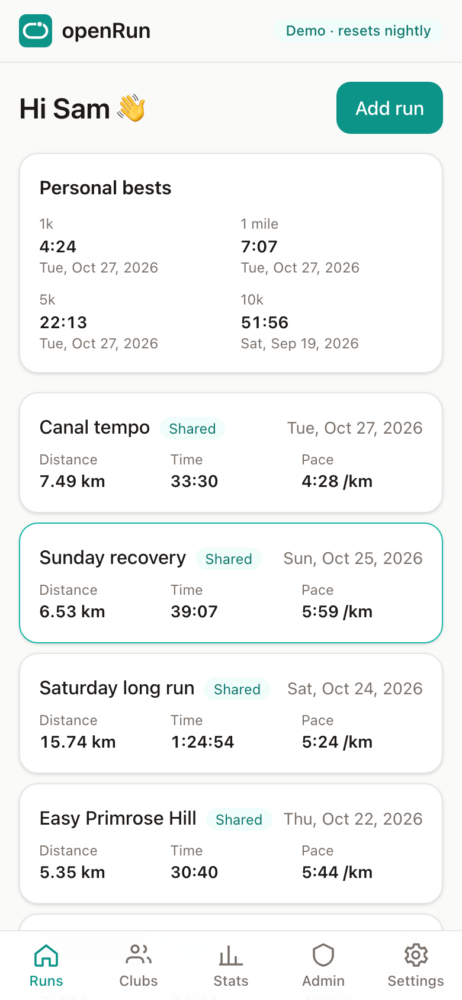
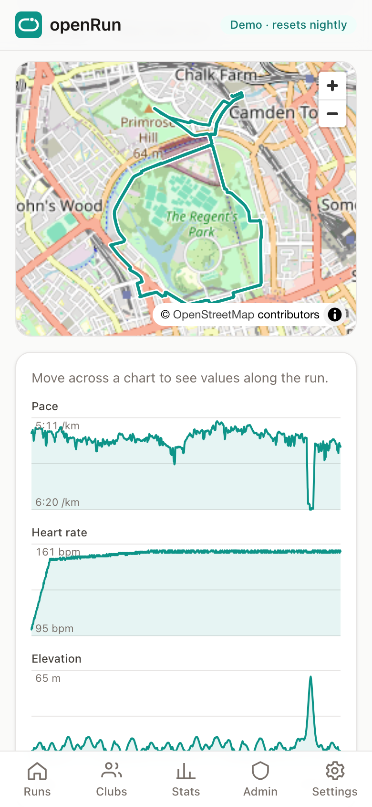
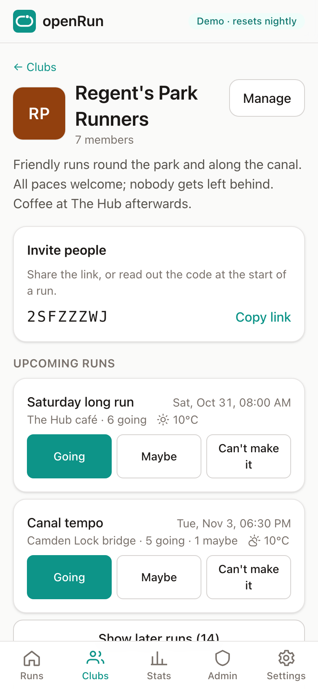
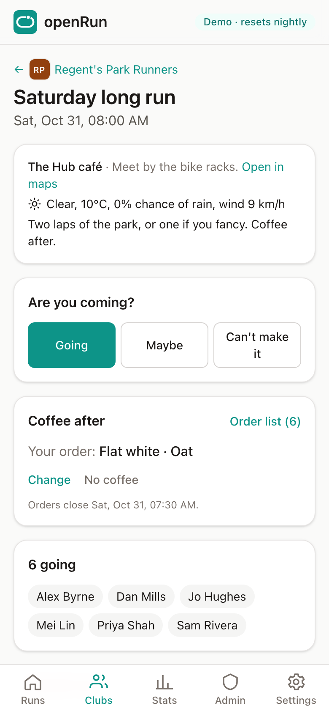

# openRun

[](https://github.com/stretch0/openRun/actions/workflows/ci.yml)
[](https://github.com/stretch0/openRun/actions/workflows/codeql.yml)
[](https://scorecard.dev/viewer/?uri=github.com/stretch0/openRun)
[](https://github.com/stretch0/openRun/releases/latest)
[](LICENSE)

An open-source, self-hosted running app: log your runs, sync from your watch, and organise your run club (including the coffee order).

Your runs are yours: they're private unless you choose to share them, and clubs only ever see what you send them. Run it for yourself, or for friends and family who trust you with their data. It's inspired by [openGym](https://github.com/DuarteSantos8/openGym).

> **Status: early development.** Accounts, the run log, stats, privacy controls, run clubs and watch sync work. v0.1 is out ([release notes](https://github.com/stretch0/openRun/releases/tag/v0.1.0)). See [ROADMAP.md](ROADMAP.md).

<table>
  <tr>
    <td><picture><source media="(prefers-color-scheme: dark)" srcset="docs/images/runs-dark.png"></picture></td>
    <td><picture><source media="(prefers-color-scheme: dark)" srcset="docs/images/run-dark.png"></picture></td>
    <td><picture><source media="(prefers-color-scheme: dark)" srcset="docs/images/club-dark.png"></picture></td>
    <td><picture><source media="(prefers-color-scheme: dark)" srcset="docs/images/club-run-dark.png"></picture></td>
  </tr>
</table>

## Features

|                                                                                | Status |
| ------------------------------------------------------------------------------ | ------ |
| Accounts with passkeys or password, first user becomes admin, invite-only mode | ✅     |
| Installable PWA (works offline from cache, update prompt)                      | ✅     |
| Single Docker image with SQLite, migrations applied on start                   | ✅     |
| Run log: FIT/GPX import, maps, splits, PBs, shoes, stats, export               | ✅     |
| Privacy: private by default, sharing settings, privacy zones                   | ✅     |
| Run clubs: repeating runs, RSVPs, coffee orders, weather, reminders            | ✅     |
| Watch sync via intervals.icu (Garmin, Coros, Polar, Suunto, Wahoo)             | ✅     |

## Self-hosting with Docker

```bash
curl -O https://raw.githubusercontent.com/stretch0/openRun/main/docker-compose.yml
curl -o .env https://raw.githubusercontent.com/stretch0/openRun/main/.env.example
```

Set `BETTER_AUTH_SECRET` (`openssl rand -base64 32`) and `ORIGIN` (the URL people will use) in `.env`, then:

```bash
docker compose up -d
```

Open the URL. The first account you create becomes the admin. Everything is stored in `./data` (see [Backups](#backups)).

Passkeys need HTTPS (or `localhost`), so put openRun behind a reverse proxy such as Caddy or Traefik for anything beyond local use. When you do, set `TRUST_PROXY=true`. All settings are listed in [.env.example](.env.example). To run a public demo with sample data instead, see [docs/DEMO.md](docs/DEMO.md).

### Upgrading

Back up first, then:

```bash
docker compose pull
docker compose up -d
```

Database changes are applied when openRun starts; `docker compose logs openrun` shows how many. There's no way back to an older version except restoring the backup you made before upgrading. `latest` follows every change on `main`; to upgrade only when you choose, pin a release in `docker-compose.yml` (for example `ghcr.io/stretch0/openrun:0.1`).

### Backups

Everything lives in two places: the `./data` folder and your `.env`. Keep `.env` safe as well, because `BETTER_AUTH_SECRET` signs everyone's sessions and encrypts their intervals.icu keys. A database restored without it works, but everyone has to sign in and paste their intervals.icu key again.

`./data` holds:

| Path                                  | What it is                                                                |
| ------------------------------------- | ------------------------------------------------------------------------- |
| `openrun.db` (plus `-wal` and `-shm`) | The database: accounts, runs, clubs, settings                             |
| `files/`                              | Original FIT and GPX files                                                |
| `vapid.json`                          | Push notification keys (losing them means everyone turns pushes on again) |
| `backups/`                            | Copies made by `backup.js`                                                |

The simplest backup is to stop openRun, copy the folder and start it again:

```bash
docker compose stop
tar czf openrun-$(date +%F).tar.gz data .env
docker compose start
```

To back up without stopping, copy the database with the built-in command first (copying `openrun.db` itself while openRun runs can miss recent changes), then archive the folder:

```bash
docker compose exec openrun node backup.js
tar czf openrun-$(date +%F).tar.gz --exclude='data/openrun.db*' data .env
```

The archive then holds the database copy from `data/backups/`. Delete old copies from `data/backups/` now and then.

To restore, stop openRun, unpack the archive, and if it came from `backup.js`, put that copy in place as `openrun.db`:

```bash
docker compose stop
tar xzf openrun-2026-10-30.tar.gz
rm -f data/openrun.db-wal data/openrun.db-shm
cp data/backups/openrun-2026-10-30T0915.db data/openrun.db   # only for backup.js copies
docker compose start
```

A backup from an older version is upgraded when openRun starts.

### Forgotten passwords

There's no password reset by email, and admins can't reset passwords from inside the app. Whoever runs the server can:

```bash
docker compose exec openrun node reset-password.js someone@example.com
```

It prints a temporary password and signs that person out everywhere. Send it to them privately; they can change it in Settings.

## Your data and privacy

- Runs are visible only to their owner unless they choose to share them.
- Shared runs show the route only if the owner allows it, with their privacy zones cut out.
- Admins manage invites and settings; they can't see other people's runs.
- Whoever runs the server can read what's stored on it, as with any server. Set `INSTANCE_CONTACT` so members know who that is, and only host data for people who trust you.

The full design, including plans for clubs that connect separate instances, is in [docs/PRIVACY.md](docs/PRIVACY.md).

## Development

You need Node 22 or later.

```bash
npm install
npm run dev
```

The API runs on http://localhost:3000 and the PWA on http://localhost:4200, which proxies `/api` to the API. The development database is created at `./data/openrun.db`.

If something else already uses port 3000, pick another for the API; the PWA follows it:

```bash
PORT=3005 npm run dev
```

| Command                                        | What it does                                             |
| ---------------------------------------------- | -------------------------------------------------------- |
| `npm run dev`                                  | API and web app in watch mode                            |
| `npm run lint`                                 | ESLint and type checks                                   |
| `npm test`                                     | Unit tests (Vitest)                                      |
| `npm run e2e`                                  | Playwright tests against the production build            |
| `npm run db:generate -- --name=<description>`  | Generate a migration after changing `libs/db/src/schema` |
| `npx nx affected -t lint typecheck test build` | Only what your change affects                            |

The repo is an [Nx](https://nx.dev) monorepo. See [docs/ARCHITECTURE.md](docs/ARCHITECTURE.md) for how it fits together.

## Licence

[AGPL-3.0-or-later](LICENSE). If you run a modified openRun for other people, you must share your changes.
